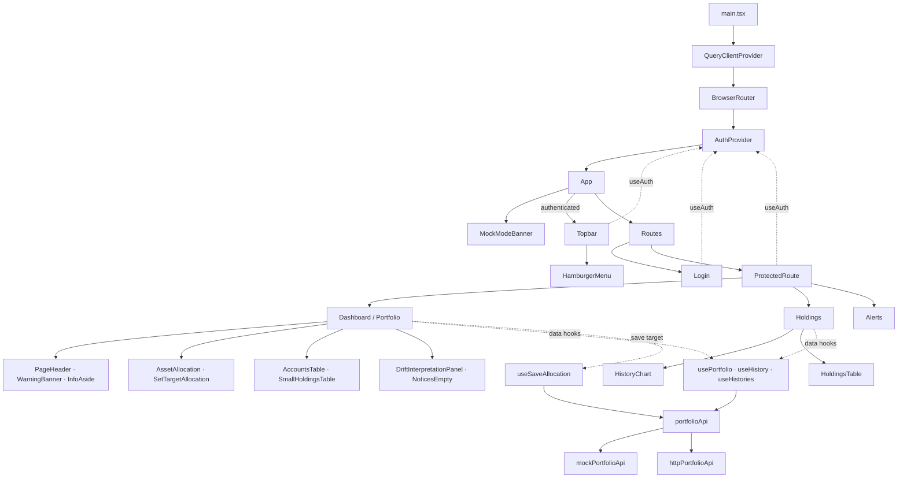

# Avanza Frontend

Frontendapplikationen för **Avanza Portföljhälsa v2** är utvecklad med React 18, TypeScript och Vite. Den underhålls separat från Spring Boot-backend.

## Environment

### Required tools

- Node.js 22 LTS eller senare
- npm

### Main frontend technologies

- React 18
- TypeScript
- Vite
- TanStack Query
- React Router
- Recharts
- CSS Modules
- Vitest och React Testing Library

Alla kommandon nedan körs från katalogen `frontend/`, om inget annat anges.

## Install dependencies

Från repositoryts rot:

```powershell
cd frontend
npm install
```

Kör `npm install` igen efter ändringar i `package.json` eller `package-lock.json`.

## Start the Vite development server

```powershell
npm run dev
```

Utvecklingsservern startas normalt på:

```text
http://localhost:5173
```

Vite stöder Hot Module Replacement, vilket gör att ändringar normalt visas direkt i webbläsaren.

För att göra servern tillgänglig på det lokala nätverket:

```powershell
npm run dev -- --host
```

## Build and preview the production bundle

Bygg frontenden:

```powershell
npm run build
```

Kommandot kontrollerar TypeScript och skapar produktionsfilerna i `dist/`.

Förhandsgranska produktionsbygget:

```powershell
npm run preview
```

Öppna normalt:

```text
http://localhost:4173
```

Preview-servern ersätter inte Spring Boot-backend.

För mer information om drift och backendmiljö, se [DRIFT.md](../DRIFT.md).

## Available npm scripts

| Kommando | Funktion |
|---|---|
| `npm run dev` | Startar utvecklingsservern |
| `npm run build` | Kör TypeScript-kontroll och bygger applikationen |
| `npm run preview` | Förhandsgranskar produktionsbygget |
| `npm run lint` | Kontrollerar kodstandard |
| `npm run test` | Kör automatiserade tester med Vitest |

## Architecture

Frontenden är uppdelad i återanvändbara komponenter, sidor, hooks och ett separat API-lager.

| Katalog | Ansvar |
|---|---|
| `src/pages/` | Applikationens sidor |
| `src/components/` | Återanvändbara UI-komponenter |
| `src/hooks/` | Datahämtning och återanvändbar logik |
| `src/api/` | API-klient, kontrakt och adapters |
| `src/auth/` | Autentiseringsfunktionalitet |
| `src/types/` | TypeScript-typer |
| `src/lib/` | Beräkningslogik och hjälpfunktioner |
| `src/data/` | Lokal exempeldata |

## Frontend component structure

The diagram shows the application shell and route components, their main UI
children, and the shared authentication and portfolio data layers.



TanStack Query används för asynkron datahantering.

API-lagret är utformat för att separera gränssnittet från datakällorna. Det har gjort det möjligt att utveckla frontend parallellt med backend.

Arkitekturella vägval dokumenteras i [BESLUT.md](../docs/frontend/BESLUT.md).

## Implemented functionality

Frontendkoden innehåller följande funktioner:

| Funktion | Beskrivning |
|---|---|
| Portföljöversikt | Visar portföljvärde, konton och tillgångsfördelning |
| Målallokering | Användaren kan ange önskad fördelning mellan olika tillgångskategorier |
| Driftberäkning | Beräknar avvikelsen mellan faktisk och önskad allokering |
| Driftvarning | Visar information när avvikelsen överstiger definierad tröskel |
| Innehav | Visar portföljens innehav |
| Historik | Komponenter för visualisering av värdeutveckling |
| Hjälpinformation | Förklarar riskallokering och närliggande begrepp |
| Navigation | Sidnavigering och meny för mindre skärmar |
| Autentisering | Inloggningsflöde och skyddade routes |

Tabellen beskriver funktionalitet i frontendkoden och innebär inte att alla flöden är verifierade mot backend.

## Portfolio data

Portföljdata hanteras genom `src/api/portfolioApi.ts`.

Kodbasen innehåller två adapters:

- `mockPortfolioApi` – använder lokal exempeldata.
- `httpPortfolioApi` – använder HTTP-anrop mot backend.

Lokal portföljdata finns i:

```text
src/data/portfolio.json
```

Miljövariabeln `VITE_USE_MOCK` väljer vilken adapter som används.

Denna konfiguration finns kvar som en del av kodbasen, men teamet planerar inte något nytt demoläge inför slutleveransen.

## Authentication mode

Autentisering styrs av `VITE_USE_MOCK` i `frontend/.env.development`.

| Värde | Beteende |
|---|---|
| `true` | Använder lokal mockautentisering |
| `false` | Använder backendens autentiserings-API |
| Saknat eller ogiltigt | Ger ett konfigurationsfel |

Exempel på backendkonfiguration:

```env
VITE_USE_MOCK=false
VITE_API_BASE_URL=http://localhost:8082
```

Backendläget skickar inloggningsanrop till `/api/auth/login`.

Backendfel ska inte automatiskt leda till att mockautentisering aktiveras.

Observera att `VITE_USE_MOCK` påverkar både autentisering och portföljdata.

Starta om utvecklingsservern efter ändringar i miljövariablerna.

För automatiserade tester konfigureras autentiseringsläget separat i `vite.config.ts`.

## Scope (current)

- Ingen live-FX-funktion i frontendens dokumenterade flöde.
- Pensionskontot i lokal exempeldata har värdet 0 SEK.
- Drift beräknas i frontend via `src/lib/drift.ts`.
- Drifttröskeln är 5 % i lokal exempeldata.
- Den förberäknade JSON-flaggan används inte som källa för driftvarningen.

Drift beräknas enligt:

```text
|actual − target| > thresholdPct
```

## Customer feed forward

Efter kunddemonstrationen fick teamet återkoppling om hur lösningen kunde förbättras.

Återkopplingen sammanställdes i en omtagsplan som låg till grund för prioriteringen inför slutleveransen.

### Förståelse för portföljinformationen

Kunden efterfrågade tydligare förklaringar av:

- Målallokering.
- Skillnaden mellan aktiers och fonders risknivåer.
- Riskspridning och dess praktiska betydelse.
- Rebalansering.

Frontendteamet prioriterade pedagogiskt innehåll och hjälpinformation i gränssnittet.

Komponenten `InfoAside` innehåller information om riskallokering. Den slutliga omfattningen av övriga förklaringar behöver kontrolleras mot omtagsplanen.

### Förbättrat modalbeteende

Kunden efterfrågade att användaren skulle kunna stänga målallokeringsmodalen genom att klicka utanför den.

Modalen skulle även stängas automatiskt när användaren sparat sitt mål.

Båda beteendena finns implementerade i `Dashboard.tsx`.

Modalen stängs efter ett lyckat sparande. Beteendet behöver funktionstestas i slutversionen.

### Tydligare datakällor

Kunden efterfrågade information om var extern data hämtas från.

Det ska framgå vilka uppgifter som hämtas externt och vilka som kommer från lokal exempeldata eller beräkningar i frontend.

Faktiska datakällor och eventuell kvarstående begränsning behöver redovisas vid överlämningen.

## Integration and delivery scope

Frontendteamet har utvecklat ett API-lager för kommunikation med backend.

HTTP-adaptern innehåller bland annat anrop för:

- Portföljinformation.
- Historik.
- Målallokering.
- Autentisering.

Alla dessa flöden är inte nödvändigtvis fullständigt verifierade mot backend.

### Decision: No further backend integration

Inför slutleveransen beslutade teamet att inte genomföra ytterligare backendberoende integrationer.

Backendteamet har avslutat sitt utvecklingsarbete och ytterligare integration skulle medföra beroenden som inte kan hanteras inom återstående projekttid.

Frontendteamet fokuserar därför på:

- Verifiering av befintlig funktionalitet.
- Testning och kvalitetssäkring.
- Dokumentation av implementationen.
- Redovisning av kända begränsningar.
- Överlämning av kod och tekniska beslut.

Ofullständiga integrationer dokumenteras som kvarstående arbete.

Beslutets motivering och konsekvenser ska även dokumenteras i [BESLUT.md](../docs/frontend/BESLUT.md).

## Testing

Frontendteamet använder Vitest, React Testing Library och jsdom.

Tester finns bland annat för:

- Autentiseringslogik.
- Inloggningsformulär.
- Målallokering.
- Driftberäkning.
- Utvalda UI-komponenter.

En GitHub Actions-workflow kör lint, tester och build vid pull requests mot `develop`.

### Previously documented test results

| Kontroll | Tidigare dokumenterat resultat |
|---|---|
| TypeScript-kontrakt | Godkänt 2026-09-02 |
| JSON-struktur | Manuellt kontrollerad mot issue #24 |
| Ursprungligt smoke-test | Dokumenterat som godkänt |

Dessa resultat avser tidigare testtillfällen och ska inte förväxlas med en verifiering av den slutliga versionen.

### Final verification

Före överlämningen ska tillgängliga tester köras och resultaten dokumenteras.

Rekommenderade kommandon:

```powershell
npm run lint
npm run test
npm run build
```

Manuell verifiering bör också omfatta navigation, målallokering, modalbeteende, felhantering och tillgänglighet.

Funktioner som inte kan verifieras mot backend ska redovisas som ej verifierade.

## Design system and styling

Frontenden använder globala CSS-filer och komponentspecifika CSS Modules.

- `src/index.css` innehåller globala stilar, resets och variabler.
- `src/App.css` hanterar applikationens övergripande layout.
- Komponentspecifika CSS-filer placeras tillsammans med respektive komponent.

Dokumenterad namngivningskonvention är `camelCase` för CSS-klasser och identifierare.

Se [STYLING.md](STYLING.md) för utförligare riktlinjer.

## Known limitations

Följande områden har medvetet avgränsats från slutleveransen:

- Ytterligare backendintegration.
- Analys av hur utländska valutor påverkar hela portföljen.
- Fullständig anpassning till mycket små mobilskärmar.
- Native-baserad backtesting i frontend.
- Individuella native-riskvärden per aktie.
- Avancerade strategijämförelser.

Fortsatt utveckling kan även krävas för historik-API, sessionshantering och ytterligare integrationsverifiering.

Dessa avgränsningar är en del av teamets prioriteringsbeslut och dokumenteras för att underlätta fortsatt utveckling.

## Team decisions and contributions

Frontendteamet har dokumenterat tekniska beslut och individuella bidrag under projektets gång.

| Dokument | Innehåll |
|---|---|
| [BESLUT.md](../docs/frontend/BESLUT.md) | Tekniska beslut, motiveringar och avgränsningar |
| [BIDRAG.md](../docs/frontend/BIDRAG.md) | Individuella bidrag, AI-användning och koppling till issues/PR |
| [Frontend-dokumentation](../docs/frontend/README.md) | Översikt över dokumentationsstrukturen |
| [STYLING.md](STYLING.md) | Stylingregler och komponentkonventioner |

Beslutsloggen omfattar bland annat CSS-struktur, datahantering, API-adaptrar, driftberäkning, autentisering och testverktyg.

För varje nytt betydande tekniskt beslut dokumenteras beslut, motivering, avgränsning och konsekvens.

## Handover

Frontendteamets slutleverans omfattar befintlig implementation, dokumentation, beslut och tillgängliga testunderlag.

Efter kundens feed forward har teamet prioriterat förbättrad begriplighet, användarvänlighet och kvalitetssäkring.

Eftersom backendteamet avslutat sitt arbete genomför frontendteamet inga ytterligare backendberoende integrationer.

Syftet med överlämningen är att nästa utvecklare eller team ska kunna:

- Installera och köra frontendprojektet.
- Förstå applikationens arkitektur och komponentstruktur.
- Följa tidigare tekniska beslut.
- Se vad som implementerats och verifierats.
- Identifiera kvarstående begränsningar och möjliga nästa utvecklingssteg.

För projektets övergripande dokumentation, se [README i repositoryts rot](../README.md).
